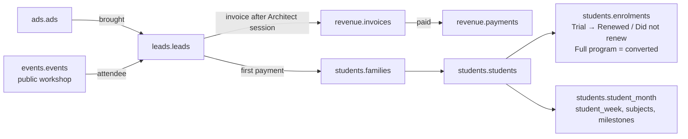

# Alcovia reporting database

Postgres, six schemas by domain. n8n writes the tables; Metabase reads them. Derived numbers (percentages, totals, colours, Scale / Refresh / Drop) are not stored; the KPI queries in [`../sql`](../sql) work them out, so they always agree with the raw data. DDL: [`schema.sql`](schema.sql).

| Schema | Holds | Who can read it |
|---|---|---|
| `students` | Families and students on the platform: profile, plan (enrolments), in-app progress | Everyone |
| `leads` | Families still in the conversion stages, not on the platform yet | Everyone |
| `events` | Workshops, quiz, advisor sessions and the rest Alcovia runs: planned vs held, ratings, what each family is owed | Everyone |
| `ops` | Advisors, alerts sent to them, shared settings (as-of date, 45-day target, colour thresholds) | Everyone |
| `ads` | Meta campaigns, ads, daily spend, money and ad targets, landing pages | Product, data, analytics, leadership |
| `revenue` | Invoices and payments | Product, data, analytics, leadership |

## How a family moves through it

The lead row stays after the family pays, so the funnel history is kept. `students.families.lead_id` points back to it.

## Tables

**students**

| Table | One row per | Filled from |
|---|---|---|
| `families` | family on the platform, linked to its lead | First payment |
| `students` | student: advisor, startup (quarter theme), career roadmap, health linked | Advisor portal |
| `enrolments` | plan: Trial (In trial / Renewed / Did not renew) or Full program (Active). The conversion state machine | Razorpay + ClickUp |
| `student_month` | student per month: counted minutes, quiz, syllabus vs pace, readiness, attendance, tasks, deadlines, sleep | App + portal + event system + notes |
| `student_week` | student per week: counted minutes, sleep, active minutes | App + Apple Health / Health Connect |
| `subject_progress` | student per subject: syllabus vs pace, readiness, latest score vs target | Portal + notes extraction |
| `soft_skill_scores` | student per skill: first vs latest workshop score | Workshop host |
| `milestones` | milestone: track, due month, status | Notes → n8n + LLM |
| `app_sessions` | focus / quiz / game session, minutes, linked timetable slot | Student app |
| `timetable_slots` | advisor-built timetable slot pushed to the app | Advisor portal |
| `quiz_attempts` | student per 8 PM quiz: score, topic, optional rating | Student app |
| `health_daily` | student per day: sleep, active minutes | Apple Health / Health Connect |
| `pulse_responses` | 1-tap answer (timetable pulse, quarter-end theme rating) | Student app |
| `tasks` | task: assigned, due, completed, estimated vs actual hours | Student app + portal |
| `score_targets`, `exam_results` | target and result per subject per exam (formative, unit test, half-yearly), parent confirmed | Portal + notes |
| `chapters` | chapter: stages done (1–5), completed on, readiness | Portal + app |
| `sprints` | monthly sprint for students behind: chapters planned vs recovered, rating | Notes + app |
| `roadmaps`, `competitions`, `summer_applications`, `content_items` | career / personal roadmap; competition entries and outcomes; summer applications; shoots, clips, podcasts | Notes, ClickUp content tracker |

**leads**

| Table | One row per | Filled from |
|---|---|---|
| `leads` | family who came in, with the date of each funnel step, interview outcome, closed and why | n8n lead webhook + ClickUp |
| `v_lead_state` (view) | lead with its state: Open / Closed / Trial / Converted, first payment date, conversion date | Built from `students.enrolments`, so no money is involved |

**events**

| Table | One row per | Filled from |
|---|---|---|
| `event_types` | kind of event, with its level (day / week / month / quarter) | Fixed list |
| `events` | event: date, venue, seats sold, attended. Public workshops today; program events once the event system is live | Razorpay links + check-in / event system |
| `delivery_month` | event type per month: planned, held, attendance, ratings | Event system |
| `family_deliverables` | student per item owed this quarter: planned vs done (parent view) | Event system |
| `event_attendance` | student or parent per event: attended, participation score | Event system |
| `event_ratings` | 1-tap rating per event by student or parent | Event system |
| `event_follow_ups` | action agreed in an advisor session or mentor call, completed on | Advisor notes |

**ops**

| Table | One row per | Filled from |
|---|---|---|
| `settings` | shared setting: as-of date, days-to-decide target, invoice and renewal colour thresholds | Data team |
| `advisors` | advisor | Advisor portal |
| `alerts` | alert sent to an advisor about a student | n8n |
| `advisor_reviews` | student per month: re-evaluation done, targets aligned with parents, support assigned | Advisor portal |

**ads** (restricted)

| Table | One row per | Filled from |
|---|---|---|
| `targets` | money and ad target: revenue and volume targets, prices, cost ceilings, refresh frequency, venue cost, weeks before Drop | Leadership |
| `campaigns` | Meta campaign (Program or Workshop) | Meta Ads |
| `ads` | ad creative | Meta Ads |
| `ad_daily` | ad per day: spend, impressions, clicks, frequency | Meta Ads, daily |
| `page_daily` | landing page per day: visitors, drop-offs, load times | GA4 + Clarity + PageSpeed |

**revenue** (restricted)

| Table | One row per | Filled from |
|---|---|---|
| `invoices` | program invoice, issued and paid dates | Razorpay invoices |
| `payments` | payment: full program, trial, trial renewal, workshop seat, with entry path and ad | Razorpay webhook |

## Rules the schema carries

- **Conversion** = a Full program enrolment, paid directly or reached by renewing a trial. A student whose only enrolment is a Trial is in the Trial state.
- **Funnel steps** are dates on the lead. A step "reached" = date filled. ClickUp keeps the full stage history.
- **Entry path** (Ads / Workshop) and the **ad** sit on both leads and payments, so leads and revenue trace back to a creative.

## Access

| Role | For | Sees |
|---|---|---|
| `full_access` | Product, data, analytics, leadership | All six schemas |
| `team_access` | Advisors, GTM team | `students`, `leads`, `events`, `ops`. No `ads` or `revenue` (checked: permission denied) |
| `n8n_writer` | The pipelines | Reads and writes all six |

Metabase connects twice, once per role. The GTM team sees campaign numbers only through the Campaigns / Actions dashboards leadership shares with them in Metabase.

## Sample data

Loaded from the two dashboards' sample files by [`build_seed.py`](build_seed.py) into [`seed.sql`](seed.sql). Families from the GTM sample who paid (trial or full) become `students` rows linked to their lead (`Family 0442` → lead `L0442`, family `F0442`, student `S0442`). The 20 students of the P4 sample (`S01`–`S20`) have no lead: they joined before lead tracking.

| Schema | Tables | Rows |
|---|---|---|
| `students` | 22 | 12,349 |
| `leads` | 1 | 1,524 |
| `events` | 7 | 2,210 |
| `ops` | 4 | 92 |
| `ads` | 5 | 2,092 |
| `revenue` | 2 | 542 |

**Summaries and raw tables.** `student_month`, `student_week`, `subject_progress` and `events.delivery_month` are the monthly / weekly summaries the P4 dashboard reads. The raw tables (app sessions, quiz attempts, health, timetable, tasks, targets, exams, chapters, sprints, roadmaps, competitions, applications, content, attendance, ratings, follow-ups, advisor reviews) hold made-up rows for the 20 P4 sample students, drawn by [`build_raw_sample.py`](build_raw_sample.py) from each student's monthly figures. In production n8n fills the raw tables and builds the summaries from them. Not modelled yet: `notes_extractions` (field, value, source sentence, confidence) for the ClickUp notes pipeline.
